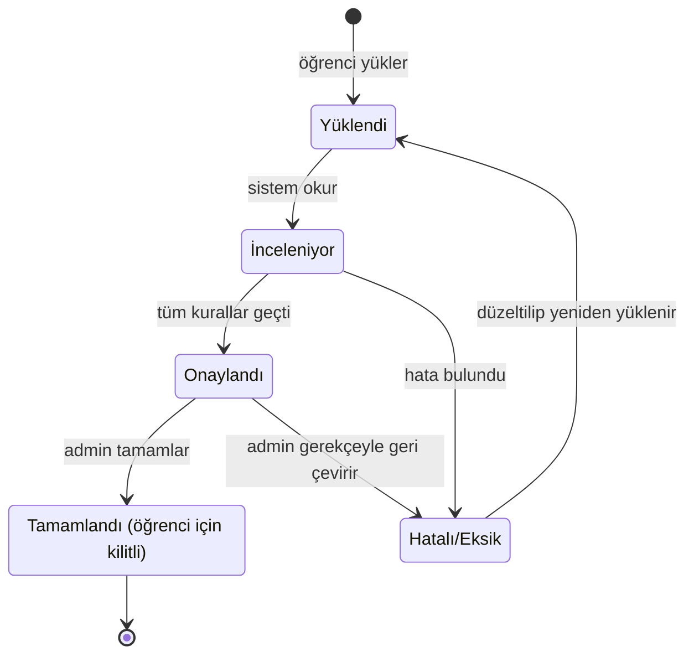
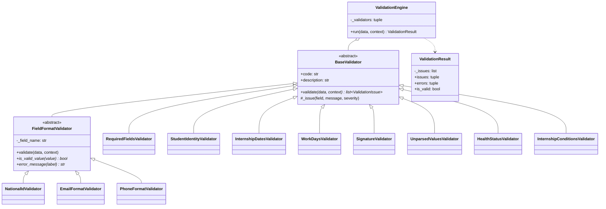
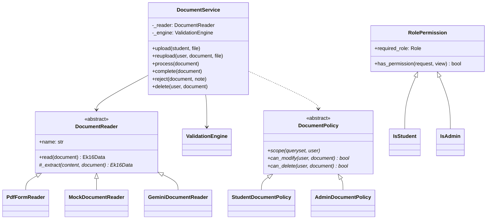
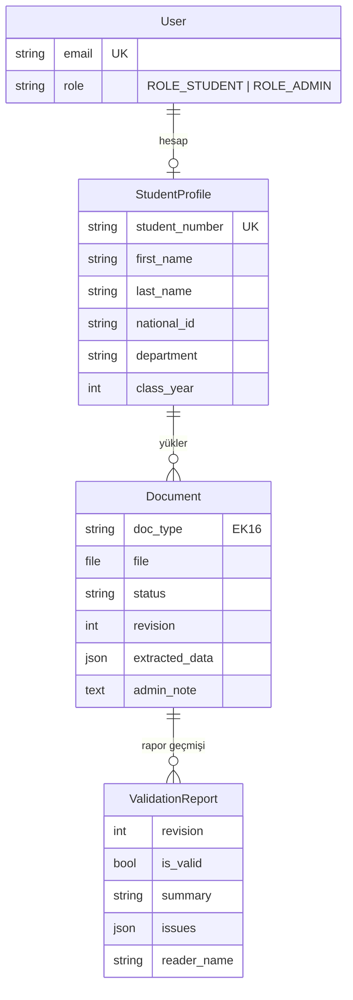
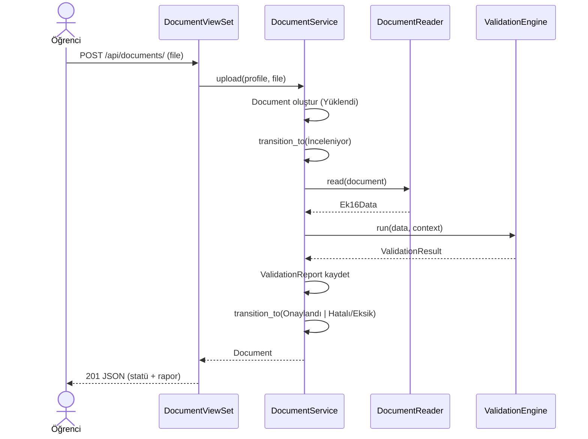

# Diyagramlar

GitHub ve VS Code (Markdown Preview Mermaid eklentisi) bu diyagramları doğrudan çizer.
PNG gerekirse: `npx @mermaid-js/mermaid-cli -i diyagramlar.md -o diyagram.png`.

## Belge statü akışı

## Denetleyici hiyerarşisi (kalıtım + çok biçimlilik)

## Okuyucu ve politika soyutlamaları

## Veri modeli

## Yükleme akışı

